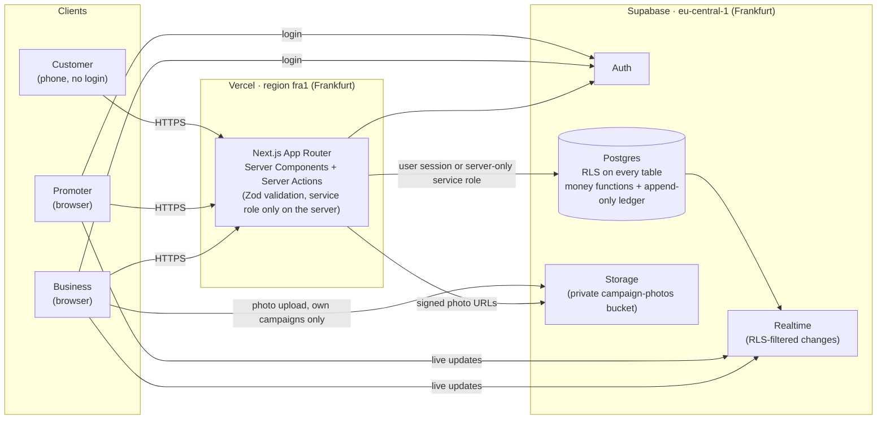
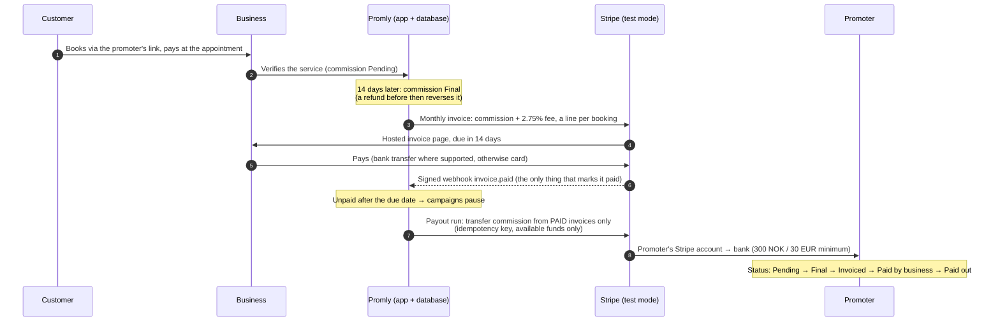

# Promly — Businesses get customers. People get paid.

**Live:** https://promly-eight.vercel.app

Businesses that sell online (tours, rentals, experiences, event and club tickets, classes and memberships) pay for ads whether or not anyone books, while people recommend experiences to their friends every day for free. **Promly is a performance-based marketing marketplace that connects the two.** A business publishes a campaign with a commission. Anyone can join it as a promoter and share a personal link or QR code. When a referred customer books and the business confirms the service actually happened, the promoter earns the full commission. Businesses only pay for real, verified customers, and anyone can be a marketer.

> Built during **Oslo Sprint, 6–8 Nov 2026**.

---

## How it works

1. **Business publishes.** A boat-tour company with online booking creates "Sunset Fjord Cruise — 500 NOK", sets a 100 NOK commission, accepts the standard promoter agreement and publishes.
2. **Promoter joins.** The campaign appears instantly on every promoter's Explore page. A promoter reads the agreement, accepts it and gets a personal referral link and QR code to share (marked as advertising, following the business's brand rules).
3. **Customer books.** A friend opens the link or scans the QR code on their phone, picks a time and books with a name and phone number. No account needed.
4. **Business verifies.** The booking appears live on the business dashboard. After the appointment, the business clicks **Verify service completed**. The commission is now *pending*.
5. **Promoter gets paid.** When the refund window has passed, the commission becomes *available* and appears live on the promoter's dashboard with its payout date.

Both dashboards update in real time from actual database changes. There are no fake animations or page refreshes.

---

## Architecture



- **Frontend and server:** Next.js on Vercel, with server functions in `fra1`, next to the database.
- **Database:** Supabase Postgres in Frankfurt. The schema is in [`supabase/migrations/`](supabase/migrations).
- **Writes:**
  - Logged-in users read and write through their own session, limited by Row Level Security.
  - Anything that moves money goes through Postgres functions that only the server can call.
- **Realtime:** browsers subscribe to Supabase Realtime. Changes are filtered by the same RLS policies, so each user only ever receives their own data.

---

## The money model

All amounts are stored as **integers in minor units** (øre / cents). Fees are calculated only on the server.

- The **promoter keeps 100%** of the advertised commission.
- The **business pays a platform fee on top**: `PLATFORM_FEE_BPS = 275` (2.75%) of the **booking price**, rounded half-up.

| Example: Sunset Fjord Cruise | NOK | stored as (øre) |
|---|---:|---:|
| Booking price | 500.00 | 50 000 |
| Commission → **promoter** | 100.00 | 10 000 |
| Platform fee 2.75% × 500 → **Promly** | 13.75 | 1 375 |
| **Business pays per verified booking** | **113.75** | **11 375** |

The Spain example works the same way: €150 jet ski, 20% commission = €30.00, fee 2.75% × 15 000 = 412.5 → **413 cents**, so the business pays €34.13.

- **Commission lifecycle:** booking → service verified (**pending**) → refund window ends (**available**) → payout date (7 or 14 days after verification, set in the agreement).
- **Refunds:** a refund before payout appends **reversal** entries. Old rows are never changed.
- **Frozen terms:** the price, commission, fee, currency, refund window, payout days and agreement version are **frozen on each booking**, so later campaign edits never change existing bookings.

The same maths lives in [`lib/money.ts`](lib/money.ts) and in the database function `platform_fee_minor`. A unit test checks that both give the same result.

---

## Payments and settlement (Stripe test mode)

Behind the feature flag `PAYMENTS_ENABLED` (off in production for now). Full rules: [`docs/PAYMENTS.md`](docs/PAYMENTS.md).

- **Promly never takes the customer's payment:** the customer pays the business at the appointment.
- Commission becomes **final 14 days after the business verifies** the service. A refund inside the 14 days reverses commission and fee with new ledger rows.
- Once a month each business gets **one Stripe invoice**: a line per booking (commission + 2.75% fee), due in 14 days. Unpaid after the due date → its campaigns pause.
- Promoters are paid through **Stripe Connect** (Express Dashboard, Stripe-hosted onboarding), **only from invoices the business has paid** and only from funds already available. Promly stores only the Stripe account id and whether payouts are enabled.
- Promoters are **16-17 or 18+**. 16-17 promoters see and join only 16+ campaigns, paid through a parent or guardian who holds the payout account.



**Safety:**
- Money moves only through server-only database functions.
- Webhook signatures are verified on every request, and events are deduplicated.
- Every Stripe call carries an idempotency key.
- The database refuses a second payout for the same booking.
- A live Stripe key is refused outright.

**On a protected Vercel preview,** Stripe can't reach the webhook directly, so run `stripe listen` forwarding to `/api/stripe/webhook` with the preview access header.

---

## Security

- **Row Level Security on every table:**
  - Businesses see only their own campaigns, bookings and ledger rows.
  - Promoters see only their own memberships, links, bookings and ledger rows.
  - Published campaigns are visible to logged-in users.
  - Logged-in users can write only the specific columns they need (column-level grants).
- **Money functions are server-only.** `create_booking`, `verify_booking`, `simulate_end_of_refund_window`, `release_commission` and `refund_booking` run as single transactions and can only be called with the server-side service role. The server passes the acting user's id, and the function checks that they own the business. Nobody can insert, edit or approve a commission from the browser, and a promoter can never approve their own commission.
- **Append-only ledger.** A trigger blocks every `UPDATE`, `DELETE` and `TRUNCATE` on `ledger_entries`, even from the server. The only exception is the admin demo reset, which purges demo-flagged data.
- **Idempotency.** Each one-time ledger entry has a unique key (`booking_id + entry_type + account + bucket`), so double clicks or retries can never pay twice. Verify, release and refund are safe to repeat.
- **No double bookings.** A unique index allows one active booking per business per time slot, and only slots the business has offered can be booked.
- **Customer contact details are visible only to the business.** Name and phone live in a separate `booking_contacts` table readable only by the business that owns the booking. The promoter who referred the customer never sees them, and customers never see commissions.
- **Agreements are versioned.** The business accepts before publishing and the promoter accepts when joining, each with a stored version and timestamp. An accepted agreement can never be edited; changes create a new version.
- **Photos** live in a private Storage bucket. A business can only upload to its own campaigns' folders, and photos of unpublished campaigns are not readable by others. Pages show them through short-lived signed URLs.
- **Secrets** stay out of the repo. `.env.local` is git-ignored, and the service role key is only used in server code (`import "server-only"`).

---

## What is simulated

This is a hackathon demo, so a few things are deliberately simulated and clearly labelled in the app:

- **Refund window fast-forward.** In Demo Mode the business can click **"Simulate end of refund window"** (shown in a yellow "Demo Mode · simulated" box) instead of waiting 3–7 days. It runs the same release logic as the real path.
- **No real money moves.** Balances, payout dates and fees are real database records. With `PAYMENTS_ENABLED`, invoices, payments and transfers are real **Stripe test-mode** objects (test cards, test balances); live keys are refused. Real money would need a lawyer's and an accountant's review first (see `docs/PAYMENTS.md`).
- **The agreement is a template.** Every agreement is labelled *"Agreement template, to be reviewed by a lawyer before real use"*.
- **Demo businesses are illustrative.** "Demo Fjord Boat Tours" and "Mediterranean Water Sports Demo" are not real partners. The demo booking page stands in for the business's own checkout and says so ("Demo checkout").
- **Illustrative demo data.** Prepare Stage Demo also creates 8 fictional online-checkout businesses in Oslo and Mallorca, 13 campaigns, ~20 fictional promoters and four weeks of history, all through the real booking and money functions. Logged-in pages say "Illustrative demo data". No ratings, reviews or user counts.

---

## Features

- **Business:**
  - campaign editor with agreement terms, accept and publish
  - up to 3 photos per campaign, resized in the browser
  - bookings with verify, simulate and refund
  - dashboard with sales, pending vs available commissions, fees and payout dates
  - live toasts
- **Promoter:**
  - real-time Explore
  - agreement and join
  - personal link, QR code (download and full screen), WhatsApp and the native share sheet
  - dashboard with the live "money moment" when a commission becomes available
- **Customer:** a mobile booking page with free time slots, then a confirmation. No account needed.
- **Admin:** a Demo Control Center with **Prepare Stage Demo** (reset) and a **Demo Health Check** that runs real checks.

---

## Tests

| Suite | What it covers | Command |
|---|---|---|
| **Unit (Vitest)**, `tests/*.test.ts` | Money maths (500/100 NOK, the €150 rounding case, a refund that brings every balance back to zero, TypeScript vs database fee) | `npm test` |
| **End-to-end (Playwright)**, `tests/e2e/*.spec.ts`, against the live site | Health check all green; the **full stage flow in three browsers** (business publishes → promoter sees it live and joins → QR decodes to the link → customer books on a phone → business verifies → promoter sees the commission live, including the money toast); photo upload and removal; sign-up and login for new business and promoter accounts; onboarding for accounts without a profile; clear errors for a wrong password, a duplicate email or a hung network | `npm run test:e2e` |

| **Payments rules (Vitest)**, `tests/payments.test.ts` | 113.75 kr invoice, the exact 14-day boundary, refund before/after, the 300 NOK / 30 EUR minimum rolling over, age rules, agreement template v2 | `npm test` |
| **Payments in the database (Vitest + PGlite)**, `tests/payments-db.test.ts` | Replays **every migration** on an in-memory Postgres and checks over 100 database rules: no payout from an unpaid invoice, no double payout, under-18 blocked, overdue pauses campaigns, fraud clawback credits only money Promly received, RLS per role, the old stage-demo functions unchanged | `npm test` |
| **Payments e2e (Playwright, Stripe test mode)**, `tests/e2e/payments.spec.ts` | verify → 14 days end → invoice → Stripe test payment → signed webhook → payout → "Paid out" | `E2E_PAYMENTS=1 npm run test:e2e` |

The e2e tests reset the demo before and after, and delete every account they create. `npm run build` type-checks the whole app.

---

## Running it yourself

Requirements: Node 20+ and a **hosted** Supabase project (no Docker needed).

```bash
npm install
cp .env.example .env.local   # then fill in the values below
npx supabase link --project-ref <your-project-ref>
npx supabase db push --remote # applies supabase/migrations
npm run seed-demo             # creates demo accounts (passwords go only into .env.local) and demo campaigns
npm run dev                   # http://localhost:3000
```

`.env.local` needs these variables (never commit this file):

- `NEXT_PUBLIC_SUPABASE_URL`
- `NEXT_PUBLIC_SUPABASE_PUBLISHABLE_KEY`
- `SUPABASE_SERVICE_ROLE_KEY` (server-only)
- `DEMO_MODE=true` (shows the labelled refund-window simulation)

Other scripts:

- `npm run reset-demo`: resets demo data only, and keeps uploaded demo photos
- `npm test`: unit tests
- `npm run test:e2e`: end-to-end tests (set `E2E_BASE_URL=http://localhost:3000` to run them locally)

You can try the live site by creating your own business or promoter account at [/auth/sign-up](https://promly-eight.vercel.app/auth/sign-up).

---

## Tech stack

- **Next.js 16** (App Router, Server Components, Server Actions) · **React 19** · **TypeScript**
- **Tailwind CSS** · **shadcn/ui** · **lucide** icons
- **Supabase**: Postgres, Auth, Realtime and Storage (hosted, Frankfurt)
- **Vercel**: hosting and automatic deploys from `main`, functions in `fra1`
- **Zod** for input validation · `qrcode` for QR codes
- **Vitest** and **Playwright** for tests

---

*Built during Oslo Sprint, 6–8 Nov 2026.*
